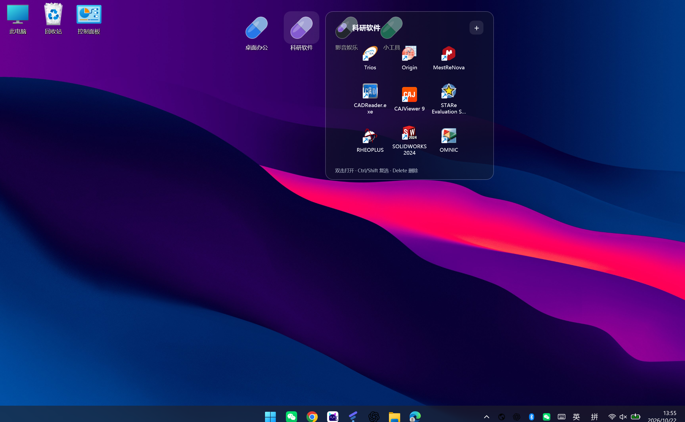
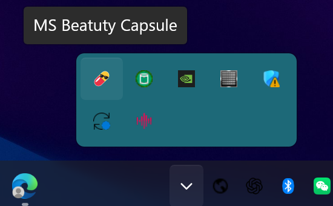
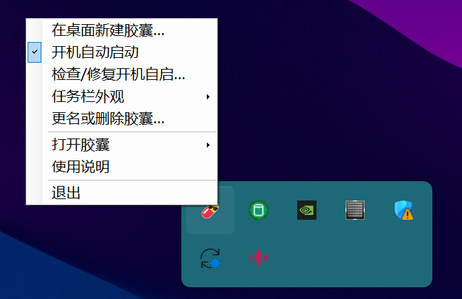
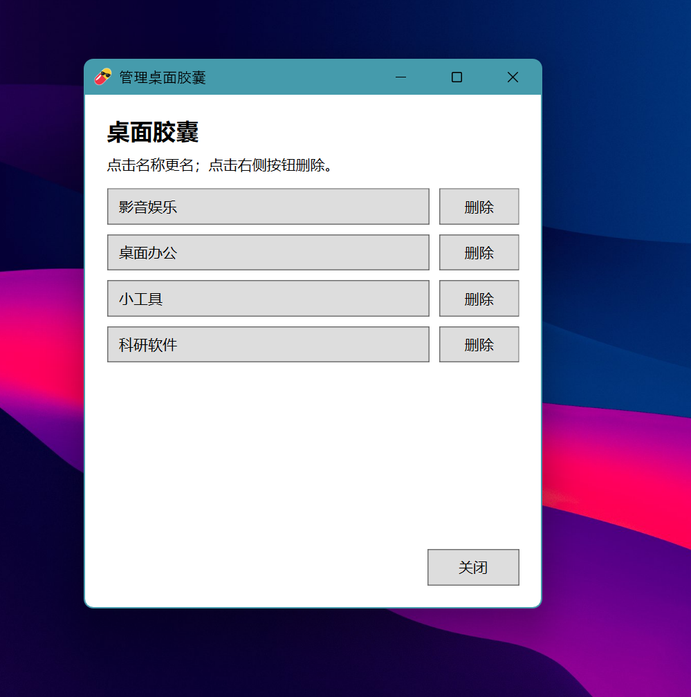

# 💊 MS Beatuty Capsule · 桌面胶囊

把常用文件和快捷方式收进几个胶囊，让桌面简单一点。

一个面向 **Windows 11 x64** 的轻量便携桌面工具。按自己的习惯创建“桌面办公”“科研软件”“影音娱乐”“小工具”等胶囊，鼠标停留半秒展开，用完回到桌面。

**免安装 · 简单分类 · 悬停展开 · 开机自启 · 本地保存**

[下载最新版](https://github.com/SHUAIMAMAX/MS-Beatuty-Capsule/releases/latest) · [反馈问题](https://github.com/SHUAIMAMAX/MS-Beatuty-Capsule/issues)



## 为什么做这个小软件

桌面上的快捷方式一多，就容易越摆越乱。这个项目希望用很少的操作，把常用入口整理好：放几个胶囊、拖入快捷方式、需要时展开。

它的产品取向是**轻量、简单、够用**。维护重心放在桌面整理、启动入口和基础外观上，克制增加复杂功能，让一个小工具保持小工具的样子。

1.0.1 继续使用单个 C# / WPF 主程序与少量必要文件，不打包浏览器内核，无需安装器或额外后台服务。完整便携 ZIP 同时包含对应源码及第三方源码包。CPU、内存和登录后启动时间尚未做跨设备基准测试。

## 基础功能

- **桌面胶囊分类**：创建多个胶囊，分别放置常用快捷方式；胶囊只放在桌面。
- **悬停半秒展开**：鼠标在胶囊上停留约 0.5 秒自动展开；其他应用盖住桌面、鼠标停在其他窗口上时不会误触发。
- **拖入即可整理**：照片、文档、音视频、压缩包、程序、快捷方式及文件夹均可拖入；胶囊只保存原路径，双击交给 Windows 默认程序打开。原文件移动或删除后，需恢复原路径或重新拖入。
- **贴合桌面网格**：读取 Windows 桌面图标的格距和位置，胶囊首行与图标首行对齐，也可放在已有图标的格子。桌面活动时会更新格距，跟随鼠标滚轮调整图标大小；读取失败时回退到固定网格。重叠时桌面图标优先，胶囊暂时不显示也不能点击，移走图标后重新出现。
- **集中更名和删除**：管理窗口列出所有胶囊，点击名称更名，点击右侧按钮删除。
- **自定义胶囊外观**：在管理列表或“胶囊更名”窗口，为默认胶囊选择 130 种颜色之一，并设置图标透明度 0–100%，默认 100% 不透明；名称保持可见。也可替换、还原图标；上传自定义图片后需先还原默认图才能换色。图片支持 PNG、JPG/JPEG、BMP、ICO；最长边 1024 像素、文件 2 MiB 以内，建议 256×256 正方形。
- **半透明壁纸毛玻璃**：展开背景按桌面位置取样并模糊壁纸，文字和图标保持清晰。
- **开机自动启动**：默认启用当前用户登录自启；先显示胶囊，再做托盘图标、自启登记检查和图标按需加载。托盘可选择“清理自启并退出”，用于停用和删除便携版前移除本副本的启动快捷方式。
- **少量基础外观**：托盘提供正常、毛玻璃、全透明三种任务栏外观选项；效果取决于 Windows 版本和系统环境。

新版添加的内容只保存原路径引用，不复制文件。删除这些条目不会删除原文件；旧版已有的快捷方式副本继续可用。自定义胶囊图会另存一份缩小后的图片到 `Data/Icons`，以便原图片移动后仍显示。展开面板随内容调整大小，不显示滚动条；内容超过屏幕可容纳范围时翻页。

## 界面预览

### 托盘入口



### 简单的托盘菜单



### 更名和删除集中管理



截图由项目使用者提供，展示实际桌面使用界面。截图中的第三方软件仅用于演示快捷方式分类，不随本项目分发。

## 适用系统

| 项目 | 要求或说明 |
| --- | --- |
| 操作系统 | Windows 11，建议 22H2 或更新版本 |
| 架构 | x64（Intel / AMD 64 位） |
| 运行环境 | .NET Framework 4.8 |
| 放置目录 | 当前用户可写的固定文件夹 |
| 权限 | 普通用户运行，无需管理员权限 |
| 暂未验证 | Windows 10、Windows ARM64 与各类定制桌面环境 |
| 其他平台 | 未提供 macOS、Linux 版本 |

壁纸毛玻璃针对**静态桌面壁纸**设计，不会实时模糊其他应用窗口或视频/动态壁纸。任务栏外观也可能受 Windows 更新、系统透明设置和其他美化工具影响。

## 下载与运行

在 [Releases 发布页](https://github.com/SHUAIMAMAX/MS-Beatuty-Capsule/releases/latest) 下载 `MS-Beatuty-Capsule-Portable-1.0.1.zip`。

1. 将完整 ZIP 解压到一个固定、可写的文件夹。
2. 运行 `MSBeatutyCapsule.exe`。
3. 右键托盘图标新建胶囊，将快捷方式拖进去。

请保留程序旁的 `vendor` 文件夹与 `MSBeatutyCapsule.exe.config`。正式程序运行后，配置、自定义图标及旧版快捷方式副本保存在同目录的 `Data` 文件夹。

### 从旧版升级

1. 从托盘菜单退出旧版。
2. 使用发布页的更新 EXE 覆盖原目录中的 `MSBeatutyCapsule.exe`。
3. 保留原有 `Data`、`vendor` 和 `.exe.config`，再运行一次新版。

单独的 EXE 用于更新现有便携版；第一次使用请下载完整 ZIP。迁移到新目录时，请带上整个 `Data` 文件夹。

## 开机自启与配置保存

这里的“开机自启”指**登录当前 Windows 用户后自动运行**。

首次正常运行时，程序按配置登记自启，默认开启。当前版本在用户的 Windows 启动文件夹中创建 `MS Beatuty Capsule Portable.lnk`，目标指向当前便携目录的 EXE，并读回核验路径和后台启动参数。

托盘中的“开机自动启动”可以关闭或开启；“检查/修复开机自启…”可以核验登记并查看实际路径。Windows 自身的“设置 → 应用 → 启动”或系统策略仍可能禁用启动项。

停用或删除前，右击托盘图标选择 **“清理自启并退出”**。它会核验并清理指向当前副本的启动快捷方式，同时保存关闭自启的选择；若清理或保存失败，程序会提示且保持运行。普通“退出”保留当前自启选择。之后可备份 `Data` 并删除便携目录；如果已经先删除程序，可按 `Win+R` 输入 `shell:startup`，手动删除 `MS Beatuty Capsule Portable.lnk`。不要删除启动文件夹中其他程序的快捷方式。

胶囊名称、位置、文件路径引用、自定义图标、任务栏模式和自启选择保存在 `Data` 中，正常重启无需重新设置。启动记录位于 `Data/Logs/startup.log`。Windows 可能延迟执行启动文件夹中的程序，新版主要减少程序自身在首个胶囊绘制前的工作，不能保证登录后立刻出现。不要只移动 EXE；移动整个目录后需要在新位置运行一次，以更新自启目标。

## 这是一个 Vibe Coding 项目

本项目由真实的个人使用需求驱动，采用 **Vibe Coding** 的方式开发：人提出需求、确定取舍并反馈实际使用问题，AI 辅助编写代码、排查问题和迭代实现。

这不是成熟度或质量保证的标签。项目仍在持续迭代，会公开实现、已知限制和验证范围，也欢迎通过 Issue 提交问题。希望把注意力放在好用、简单和可维护上，避免为了增加功能而增加功能。

当前版本完成了 271 项本地检查，覆盖文件引用、图标不透明度、动态格距定位、配置恢复、自启快捷方式和毛玻璃背景像素等行为；这些检查不等同于在所有 Windows 版本上完成实机验收。详见 [验证与已知限制](docs/验证与已知限制.md)。

## 源码与构建

主体为 C# / WPF，目标框架 `net48`，输出 x64 便携 EXE。

在 Windows 上使用 PowerShell 7（需包含 Roslyn 编译组件）进行离线构建：

```powershell
pwsh -NoProfile -File .\build-local.ps1
```

也提供 `build.ps1` 的 .NET SDK 构建方式，详见 [BUILD.txt](BUILD.txt)。测试程序随离线构建生成，不会自动运行；`PortableTests.exe` 会创建窗口，其他测试的范围见构建说明。

## 反馈问题

请尽量提供 Windows 版本、软件版本、复现步骤和相关截图。涉及启动问题时可参考 `Data/Logs/startup.log`；上传前请检查其中是否包含不希望公开的个人路径。

## 许可与致谢

项目按 **GNU GPL v3** 发布，见 [LICENSE.txt](LICENSE.txt)。

任务栏外观部分参考并使用 [TranslucentTB](https://github.com/TranslucentTB/TranslucentTB) 的 ExplorerTAP 组件，保留相应许可、源代码和第三方声明；也感谢 Microsoft Detours 与 Windows Implementation Libraries。详见 [第三方说明](THIRD-PARTY-NOTICES.txt)。

本项目是独立的个人项目。
